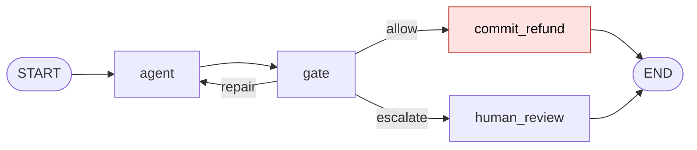
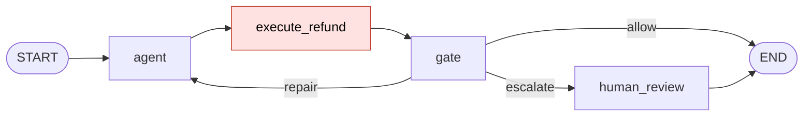

# ontology-gate-langgraph

A LangGraph refund agent with an ontology gate at runtime, and gebra's structural checks on the
graph before the run.

[](https://github.com/Gebra-Tech/ontology-gate-langgraph/actions/workflows/ci.yml)

## Where this comes from

This repository builds on Frank Coyle's AI Engineer World's Fair 2026 talk,
[Why Agentic Systems Need Ontologies](https://ai.engineer/talks/Sir59K8ZDPU-ontologies-for-agentic-systems),
and on his workshop notebooks in [compass_ai](https://github.com/frankc/compass_ai). The
guardrails notebook there builds an ALLOW / BLOCK ontology gate for a webshop refund agent and
ends with two next steps it leaves open:

1. make the gate a check the agent has to pass before any write action;
2. feed the SHACL violation messages back to the agent, so it can repair its plan.

This repository builds both, as a LangGraph agent. Four moments in the talk shape it (times are
approximate, wording paraphrased):

- **about 13:13**: agent loops can keep going, drift, and run up token costs, so iteration needs
  control;
- **about 16:15**: the check belongs after a tool returns and before its result is accepted,
  and consequential side effects wait until validation passes;
- **about 17:43**: type checking (Pydantic) and business-rule checking (the ontology) answer
  different questions;
- **about 18:59**: a second refund on the same order is one of his examples of a failure an
  ontology can catch.

This is an independent follow-up. It is not affiliated with or endorsed by Frank Coyle, and it
copies nothing from compass_ai: only the scenario idea, a support agent that proposes refunds, is
shared. The people, orders, triples, shapes and code here are new.

## The graph

The correct graph. The gate is a node; a BLOCK goes back to the agent with the policy messages,
and the refund is written only after ALLOW. After three BLOCKs the case goes to a person.



The defect graph. The refund is executed before the gate, inside the repair loop: validate after
the tool ran.



## Quickstart

With `make` and [uv](https://docs.astral.sh/uv/):

```bash
make setup   # creates .venv (Python 3.12) and installs the package with its dev tools
make demo    # runs the three cases on the correct graph, then on the defect graph
make check   # runs gebra on every graph configuration and compares with the expected matrix
make test    # runs the tests and both notebooks, with outbound network access blocked
```

With plain `pip`:

```bash
python3.12 -m venv .venv
.venv/bin/pip install -e ".[dev]"
.venv/bin/python -m ontology_gate.demo --defect
.venv/bin/python -m ontology_gate.checks
.venv/bin/python -m pytest
```

Everything runs offline. The agent is a scripted model that replays the same proposals every
run, so the output below is what you will see.

## What the demo shows

The shop knows two customers (lena, omar), two managers (priya, who is also a customer, and
marco), an AI agent (shopbot), four orders, and one refund that already exists: `rf1` on order
`o1001`. The policy has five SHACL rules: an amount of at most 1000, a referenced order, a
Manager as approver, an approver who is not the requester, and at most one refund per order.

| case | first proposal | gate says | repair |
|---|---|---|---|
| agent-approves | shopbot approves lena's 80 on o1002 | BLOCK: the approver must be a Manager | priya approves: ALLOW |
| self-approval | priya approves her own 40 on o1003 | BLOCK: the approver must not be the requester | marco approves: ALLOW |
| duplicate-refund | priya approves lena's 60 on o1001 | BLOCK: an order can be refunded only once | no approver can fix it: BLOCK three times, then human review |

`make demo` prints each attempt, the outcome and the ledger of paid refunds for both graphs. Its
last lines:

```text
summary
  correct: 2 refunds paid, 1 escalated, no order paid twice
  defect: duplicate refund for o1001 paid 3 times before escalation (7 payments in all, 3 orders paid more than once)
```

On the correct graph the duplicate is blocked three times and nothing is paid. On the defect
graph the gate blocks it the same three times, but each proposal was already paid when the gate
saw it. The agent-approves refund is paid twice there too: once for the proposal the gate
blocked, once for the repair.

## What gebra checks here

I maintain gebra. [gebra](https://github.com/Gebra-Tech/gebra#readme) reads a LangGraph graph
definition and a sidecar file of declarations (`gebra.toml`) and reports on named properties of
that definition before anything runs. It never calls a node. Three of its properties matter for
this agent:

- **P-01 `graph-well-formed`**: every node is reachable from START and has somewhere to go.
- **P-02 `termination-witness`**: every loop declares a bound. A pass records that a bound is
  declared, a witness is present. It does not say the loop terminates, and gebra does not check
  that the declaration is true.
- **P-06 `effect-safety`**: a node declared `billable` or `irreversible` that the graph can run
  again inside a loop must declare an idempotency key or a compensation hook. The effect tags and
  the protection are declarations, and gebra trusts them.

Step 2 of compass_ai's next steps creates the repair loop, which is what P-02 looks at. Step 1
puts the write after ALLOW, which is what P-06 looks at. In [`gebra.toml`](gebra.toml) the loop
variant sits on `gate`, the node that increments `repair_attempts`, and `commit_refund` is
tagged `billable` and `irreversible`. The extra sidecars in [`sidecars/`](sidecars) cover the
other configurations.

`make check` output, verbatim:

```text
configuration                     P-01  P-02  P-04  P-06  P-08  as expected
---------------------------------------------------------------------------
correct, no sidecar               pass  fail  pass  pass  pass  yes
correct, gebra.toml               pass  pass  pass  pass  pass  yes
defect, defect.toml               pass  pass  pass  fail  pass  yes
defect, defect-idempotent.toml    pass  pass  pass  pass  pass  yes
correct, negative-control.toml    pass  fail  pass  pass  pass  yes
no-escalate, gebra.toml           fail  pass  pass  pass  pass  yes
uncapped, gebra.toml              pass  pass  pass  pass  pass  yes
bypass, gebra.toml                pass  pass  pass  pass  pass  yes

findings
  correct, no sidecar: P-02 cycle-without-termination-witness (agent, gate)
    the repair loop declares no bound; no effect is declared, so P-06 has nothing to check
  correct, gebra.toml: none
    bound declared on gate; commit_refund is outside the loop
  defect, defect.toml: P-06 unprotected-effect-in-cycle (execute_refund)
    execute_refund is billable and irreversible inside the loop, with no protection
  defect, defect-idempotent.toml: none
    the declared idempotency key on order_id is accepted; it is trusted, not checked
  correct, negative-control.toml: P-02 cycle-without-termination-witness (agent, gate)
    the variant names a key that is not in the state, so it is not a bound
  no-escalate, gebra.toml: P-01 node-unreachable-from-start (human_review)
    nothing routes to human_review
  uncapped, gebra.toml: none
    limit: the declared bound is trusted, but the router no longer enforces it
  bypass, gebra.toml: none
    limit: gebra does not check that every write passes through the gate

extraction warnings on the correct graph with gebra.toml: contract-defaulted x3, contract-inferred x4
  (gebra inferred or defaulted these contract slots; warnings never change a result)

every row matches the expected matrix
```

How to read it:

- **The repair loop.** Without declarations, P-02 reports the `{agent, gate}` cycle. With the
  loop variant in `gebra.toml` it passes. The negative control names a key that is not in
  `RefundState`, and P-02 does not count it as a bound.
- **The write.** In the defect graph P-06 reports `execute_refund`: it is billable and
  irreversible, and the graph reaches it again on every repair. The finding is
  `unprotected-effect-in-cycle` rather than `-in-retry-region` because the lap reaches the write
  through the agent, not by routing straight back to it. Moving the write after ALLOW clears it.
  Declaring an idempotency key on `order_id` clears it too, but that is a declaration only: the
  demo code does not deduplicate, and the defect graph still pays three times.
- **The exit.** The `no-escalate` graph never routes to `human_review`, and P-01 reports the
  node as unreachable. Where P-01 fails, gebra treats the other topology results for that graph
  as best effort.
- **P-04 and P-08.** P-04 `dataflow-completeness` asks whether every key a node reads was written
  on every path to it; it passes on every graph here, using contracts gebra inferred from the
  node bodies. P-08 `determinism-replay` looks at nodes that declare a determinism claim; none
  does, so it has nothing to report.
- **Warnings.** `contract-inferred` and `contract-defaulted` say that gebra filled a node's
  reads, writes or effects from its code or a default, because nothing declared them. They never
  change a result.
- **No sidecar means an empty one.** Called without `sidecar=`, gebra looks for a `gebra.toml`
  from the current directory up to the repository root, and would find this repository's own
  file. The "no sidecar" row therefore passes the empty `sidecars/none.toml` explicitly.

## What gebra does not check

- **The ontology and the business rules.** Whether the shapes are right, whether a refund makes
  sense, whether the knowledge base is true: that is the gate's job, at run time.
- **That every write passes through the gate.** The `bypass` graph sends refunds under 50 from
  the agent straight to `commit_refund`. gebra passes it, and a refund approved by the AI agent
  is paid (see `tests/test_graph.py`).
- **That a declared bound is enforced.** The `uncapped` graph keeps the loop variant but its
  router ignores `MAX_REPAIRS`. gebra passes it, and the duplicate-refund case runs until
  LangGraph's recursion limit stops it.
- **Anything outside a LangGraph graph.** gebra reads LangGraph 1.x definitions. A plain
  tool-use loop has to be written as a graph before gebra can read it. Inside a graph, a route
  whose destination is computed at run time (a router with no path map, a computed `Send` or
  `Command(goto=...)` target) adds no edge to what gebra analyzes, and a counter written inside a
  router function is not visible to it. This repository uses only declared edges and increments
  `repair_attempts` in the gate node.

## Notebooks

A 45-minute exercise in the format of the compass_ai notebooks: four parts, each with a short
explanation, a demo, a ✏️ YOUR TURN cell with `____` blanks, ✅ / ❌ checks, and a 🔄 sync point so
the later parts work for everyone.

| Edition | Open |
|---|---|
| Student | [](https://colab.research.google.com/github/Gebra-Tech/ontology-gate-langgraph/blob/main/notebooks/refund_gate_STUDENT.ipynb) |
| Solution | [](https://colab.research.google.com/github/Gebra-Tech/ontology-gate-langgraph/blob/main/notebooks/refund_gate_SOLUTION.ipynb) |

Parts: A, the gate as a node; B, the repair loop (P-01 and P-02); C, where the write goes (P-06);
D, what gebra can't see. The setup cell installs this package from GitHub when it is missing, so
the notebooks run in Colab as they are. The STUDENT notebook is generated from the SOLUTION
notebook by `tools/make_student.py` (`make notebooks`), and a test checks that the committed copy
matches a fresh build.

## Optional live mode

`python -m ontology_gate.demo --live` asks a hosted model for each proposal instead of the
script: it uses Claude Haiku 5.5 (`claude-haiku-5-5`) through `langchain-anthropic`, and a
different model can be named in `ONTOLOGY_GATE_MODEL`. It needs the extra and a key:

```bash
.venv/bin/pip install -e ".[live]"
export ANTHROPIC_API_KEY=...
.venv/bin/python -m ontology_gate.demo --defect --live
```

Results vary between runs. The tests never use live mode.

## Layout

```text
src/ontology_gate/
  ontology.py   schema, knowledge base and SHACL shapes, as Turtle strings
  gate.py       gate(proposal_ttl, kb_ttl) -> GateResult(decision, violations)
  cases.py      the refund requests
  model.py      ScriptedModel (default) and LiveModel (optional)
  graph.py      build_graph(variant) for correct, defect, no-escalate, bypass, uncapped
  checks.py     run_gebra(graph, sidecar_path) and the make check matrix
  demo.py       python -m ontology_gate.demo [--defect] [--live]
gebra.toml      declarations for the correct graph
sidecars/       declarations for the other configurations
notebooks/      refund_gate_SOLUTION.ipynb and refund_gate_STUDENT.ipynb
tools/          make_student.py
tests/          gate, graph, defect, gebra, offline and notebook tests
```

## License

MIT, see [LICENSE](LICENSE).
