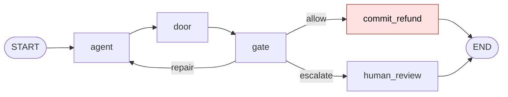
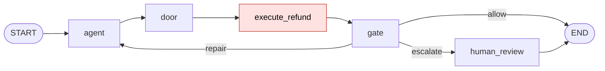

# ontology-gate-langgraph

A LangGraph refund agent with an ontology gate at runtime, and gebra's structural checks on the
graph before the run.

[](https://github.com/Gebra-Tech/ontology-gate-langgraph/actions/workflows/ci.yml)

## Where this comes from

This repository builds on Frank Coyle's AI Engineer World's Fair 2026 talk,
[Why Agentic Systems Need Ontologies](https://ai.engineer/talks/Sir59K8ZDPU-ontologies-for-agentic-systems),
and on his workshop notebooks in [compass_ai](https://github.com/frankc/compass_ai). The
guardrails notebook there builds an ALLOW / BLOCK ontology gate for a webshop refund agent and
ends with two next steps it leaves open:

1. make the gate a check the agent has to pass before any write action;
2. feed the SHACL violation messages back to the agent, so it can repair its plan.

This repository builds both, as a LangGraph agent, with one difference: his first step names a
tool or MCP server the agent must call, and here the gate is a node of the graph instead. Four
moments in the talk shape it (times are approximate, from the talk page's transcript; wording
paraphrased):

- **about 13:38 to 13:50**: agent loops can run forever, drift, and run up token costs, and his
  advice is to be careful with them;
- **about 16:45**: after the tool runs is where an ontology validator can check the result, and a
  result that does not hold goes back to the model or to a person (17:32);
- **about 18:23**: check types with Pydantic and results with the ontology, and keep the agent
  free of side effects until the ontology check has passed (18:23 to 18:41);
- **about 19:12**: a second refund on the same order is one of his examples of a failure an
  ontology can catch.

This is an independent follow-up. It is not affiliated with or endorsed by Frank Coyle. It
follows compass_ai, with credit, in four things: the scenario (a support agent that proposes
refunds), the shop schema's class hierarchy and property names, the four refund rules in
`RefundShape`, and the notebook format. New here: the SHACL form of the once-per-order rule (the
rule itself is from his talk, where a slide states it as an OWL functional property), the people,
orders and facts, the gate's handling of violations already in the knowledge base, the LangGraph
graphs, the gebra checks and all the code. compass_ai has no license file, so ask its author
before reusing the parts that follow it.

## The graph

The correct graph. The door checks the proposal's fields and types with Pydantic, and that it
answers the request; it never routes, and the gate answers BLOCK with its messages. Otherwise the
gate checks the proposal against the ontology. A BLOCK goes back to the agent with the messages,
and the refund is written only after ALLOW. After three BLOCKs the case goes to a person.



The defect graph. The refund is executed before the gate, inside the repair loop: validate after
the tool ran.



## Quickstart

With `make` and [uv](https://docs.astral.sh/uv/):

```bash
make setup   # creates .venv (Python 3.12) and installs the package with its dev tools
make demo    # runs the three cases on the correct graph, then on the defect graph
make check   # runs gebra on every graph configuration and compares with the expected matrix
make rdf     # runs the graph-as-RDF experiment and compares with the expected tables
make test    # runs the tests and both notebooks, with outbound network access blocked
```

With plain `pip`:

```bash
python3.12 -m venv .venv
.venv/bin/pip install -e ".[dev]"
.venv/bin/python -m ontology_gate.demo --defect
.venv/bin/python -m ontology_gate.checks
.venv/bin/python -m pytest
```

Everything runs offline. The agent is an offline model that reads the gate's messages: its first
proposal comes from the case, and after a BLOCK that rejects the approver it names a Manager
from the knowledge base who is not the requester. After any other BLOCK it proposes the same
refund again under a new id. It decides the same way every run, so the output below is what you
will see.

## What the demo shows

The shop knows two customers (lena, omar), two managers (priya, who is also a customer, and
marco), an AI agent (shopbot), four orders, and one refund that already exists: `rf1` on order
`o1001`. The policy has fifteen rules, and the gate checks them in three steps. The first step
that finds a problem decides.

1. **The proposal.** It describes exactly one refund, and nothing else: one subject, typed
   `shop:Refund` only, with one order, one requester, one approver and one amount. A proposal
   cannot add facts of its own, such as making its approver a Manager.
2. **The knowledge base, before any closure.** The refund id is not in use, and the order, the
   requester and the approver are already there. This comes before OWL-RL, which would type any
   object of `forOrder` as an Order.
3. **SHACL, after the OWL-RL closure.** An amount of at most 1000, an amount above 0, a named
   order, a requester, an approver, a Manager as approver, an approver who is not the
   requester, a requester who placed the order, and at most one refund per order.

| case | first proposal | gate says | repair |
|---|---|---|---|
| agent-approves | shopbot approves lena's 80 on o1002 | BLOCK: only a Manager may approve a refund | marco approves: ALLOW |
| self-approval | priya approves her own 40 on o1003 | BLOCK: the approver must not be the requester | marco approves: ALLOW |
| duplicate-refund | priya approves lena's 60 on o1001 | BLOCK: an order can be refunded only once | no approver can fix it: BLOCK three times, then human review |

`make demo` prints each attempt, the outcome and the ledger of paid refunds for both graphs. Its
last lines:

```text
summary
  correct: 2 refunds paid, 1 escalated, no order paid twice
  defect: duplicate refund for o1001 paid 3 times before escalation (7 payments in all, 3 orders paid more than once)
```

On the correct graph the duplicate is blocked three times and nothing is paid. On the defect
graph the gate blocks it the same three times, but each proposal was already paid when the gate
saw it. The agent-approves and self-approval refunds are each paid twice there too: once for the
proposal the gate blocked, once for the repair. The gate allows the second payment because it
reads a fixed knowledge base and never sees the ledger, so the first payment is not a fact it
knows about.

## What gebra checks here

I maintain gebra. [gebra](https://github.com/Gebra-Tech/gebra#readme) reads a LangGraph graph
definition and a sidecar file of declarations (`gebra.toml`) and reports on named properties of
that definition before anything runs. It never calls a node. Three of its properties matter for
this agent:

- **P-01 `graph-well-formed`**: every node is reachable from START and has somewhere to go.
- **P-02 `termination-witness`**: every loop declares a bound. A pass records that a bound is
  declared, a witness is present. It does not say the loop terminates, and gebra does not check
  that the declaration is true.
- **P-06 `effect-safety`**: a node declared `billable` or `irreversible` that the graph can run
  again inside a loop must declare an idempotency key or a compensation hook. The effect tags and
  the protection are declarations, and gebra trusts them.

Step 2 of compass_ai's next steps creates the repair loop, which is what P-02 looks at. Step 1
puts the write after ALLOW, which also takes it out of the loop; P-06 looks at the loop, not at
the gate. In [`gebra.toml`](gebra.toml) the loop variant sits on `gate`, the node that
increments `repair_attempts`, and `commit_refund` is tagged `billable` and `irreversible`. The
extra sidecars in [`sidecars/`](sidecars) cover the other configurations.

`make check` output, verbatim:

```text
configuration                     P-01  P-02  P-04  P-06  P-08  as expected
---------------------------------------------------------------------------
correct, no sidecar               pass  fail  pass  pass  pass  yes
correct, gebra.toml               pass  pass  pass  pass  pass  yes
defect, defect.toml               pass  pass  pass  fail  pass  yes
defect, defect-idempotent.toml    pass  pass  pass  pass  pass  yes
correct, negative-control.toml    pass  fail  pass  pass  pass  yes
no-escalate, gebra.toml           fail  pass  pass  pass  pass  yes
uncapped, gebra.toml              pass  pass  pass  pass  pass  yes
bypass, gebra.toml                pass  pass  pass  pass  pass  yes

findings
  correct, no sidecar: P-02 cycle-without-termination-witness (agent, door, gate)
    the repair loop declares no bound; no effect is declared, so P-06 has nothing to check
  correct, gebra.toml: none
    bound declared on gate; commit_refund is outside the loop
  defect, defect.toml: P-06 unprotected-effect-in-cycle (execute_refund)
    execute_refund is billable and irreversible inside the loop, with no protection
  defect, defect-idempotent.toml: none
    the declared idempotency key on order_id is accepted; it is trusted, not checked
  correct, negative-control.toml: P-02 cycle-without-termination-witness (agent, door, gate)
    the variant names a key that is not in the state, so it is not a bound
  no-escalate, gebra.toml: P-01 node-unreachable-from-start (human_review)
    nothing routes to human_review
  uncapped, gebra.toml: none
    limit: the declared bound is trusted, but the router no longer enforces it
  bypass, gebra.toml: none
    limit: gebra 0.2.0 has no gate-ordering rule of its own

extraction warnings on the correct graph with gebra.toml: contract-defaulted x4, contract-inferred x5
  (gebra inferred or defaulted these contract slots; warnings never change a result)

every row matches the expected matrix
```

How to read it:

- **The repair loop.** Without declarations, P-02 reports the `{agent, door, gate}` cycle. The
  door never routes, so it adds a node to the loop but no second loop. With the
  loop variant in `gebra.toml` it passes. The negative control names a key that is not in
  `RefundState`, and P-02 does not count it as a bound.
- **The write.** In the defect graph P-06 reports `execute_refund`: it is billable and
  irreversible, and the graph reaches it again on every repair. The finding is
  `unprotected-effect-in-cycle` rather than `-in-retry-region` because the lap reaches the write
  through the agent, not by routing straight back to it. Moving the write after ALLOW clears it,
  because the write is then outside the loop. Declaring an idempotency key on `order_id` clears
  it too, but that is a declaration only: the demo code does not deduplicate, and the defect
  graph still pays three times.
- **The exit.** The `no-escalate` graph never routes to `human_review`, and P-01 reports the
  node as unreachable. Where P-01 fails, gebra treats the other topology results for that graph
  as best effort.
- **P-04 and P-08.** P-04 `dataflow-completeness` asks whether every key a node reads was written
  on every path to it; it passes on every graph here, using contracts gebra inferred from the
  node bodies. With a plain `StateGraph(RefundState)` every state key counts as a graph input,
  so P-04 has nothing to report on these graphs. gebra's guide says the same of its own
  examples. The token graphs [below](#two-experiments-on-the-allow-rule) set an input schema,
  and there P-04 does report. P-08 `determinism-replay` looks at nodes that declare a determinism claim; none
  does, so it has nothing to report.
- **Warnings.** `contract-inferred` and `contract-defaulted` say that gebra filled a node's
  reads, writes or effects from its code or a default, because nothing declared them. They never
  change a result.
- **No sidecar means an empty one.** Called without `sidecar=`, gebra looks for a `gebra.toml`
  from the current directory up to the repository root, and would find this repository's own
  file. The "no sidecar" row therefore passes the empty `sidecars/none.toml` explicitly.

## What gebra does not check

- **The ontology and the business rules.** Whether the shapes are right, whether a refund makes
  sense, whether the knowledge base is true: that is the gate's job, at run time.
- **That every write passes through the gate's ALLOW branch.** gebra 0.2.0 passes the bypass
  graph shown below. It has no rule of its own for gate ordering. Its
  [guide](https://gebra-tech.github.io/gebra/guides/adopter-guide/#an-approval-gate-in-front-of-a-write)
  describes a workaround, a token the ALLOW branch writes and the write reads, and names two
  gaps: a token written before the gate, and a proposal changed after ALLOW. The
  [two experiments](#two-experiments-on-the-allow-rule) below try it on this repository's graphs.

  In the `bypass` graph, refunds under 50 go from the agent straight to the write, and in
  `tests/test_graph.py` a refund approved by the AI agent is paid this way. The edge:

  ```python
  workflow.add_conditional_edges(
      "agent", route_after_agent, {"shortcut": "commit_refund", "check": "door"}
  )
  ```

  The bypass row, as `make check` prints it:

  ```text
  bypass, gebra.toml                pass  pass  pass  pass  pass  yes
    bypass, gebra.toml: none
      limit: gebra 0.2.0 has no gate-ordering rule of its own
  ```
- **That the refund matches the request.** `gate()` does not check it either, because it never
  sees the case: on its own it would ALLOW a refund for more than the customer asked for, or one
  on another customer's order where the requester is that order's customer. In the graph the
  `door` node checks it before the gate: the same order, the same requester, and no more than
  the customer asked for.
- **That a declared bound is enforced.** The `uncapped` graph keeps the loop variant but its
  router ignores `MAX_REPAIRS`. gebra passes it, and the duplicate-refund case runs until
  LangGraph's recursion limit stops it.
- **Anything outside a LangGraph graph.** gebra reads LangGraph 1.x definitions. A plain
  tool-use loop has to be written as a graph before gebra can read it. Inside a graph, a route
  whose destination is computed at run time (a router with no path map, a computed `Send` or
  `Command(goto=...)` target) adds no edge to what gebra analyzes, and a counter written inside a
  router function is not visible to it. This repository uses only declared edges and increments
  `repair_attempts` in the gate node.

## Two experiments on the ALLOW rule

**The token workaround.** [`allow_token.py`](src/ontology_gate/allow_token.py) applies the
workaround from gebra's guide to the refund graphs. The state gets an `allow_token` key that the
input schema leaves out, `StateGraph(TokenState, input_schema=RefundState)`, so no caller can
supply it. A node `issue_token` on the ALLOW edge is the one declared writer of the key, and the
write declares the key among its reads in its sidecar. The catch: on the bypass graph and on the
graph that pays before the gate, P-04 fails with `read-key-never-written-on-path` at the write,
because a route reaches the write on which nothing wrote the token. The gated graph passes. The
two gaps: a graph that writes the token before the gate passes, because every route then carries
a token, and so does a graph that changes the proposal after ALLOW, because the token records
that the ALLOW branch ran, not what it allowed. This is P-04 answering its own question about a
declared read, and nothing in it knows which node is the gate. At run time the write here also
compares the token with the proposal it is about to pay and refuses on a mismatch; gebra does
not see that comparison. The five graphs of the check matrix have no token, so their rows above
stay as they are.

**The graph as RDF.** [`graph_as_rdf.py`](src/ontology_gate/graph_as_rdf.py) is an experiment.
gebra reads each graph (`gebra.extract`), and the script turns gebra's document into RDF in a
namespace of this repository: each node a resource, each edge a `next` statement, a node tagged
`billable` or `irreversible` a `Write`, each key a node writes a `writes` statement, and every
edge except the gate's ALLOW edge also an `unchecked` statement. Which node is the gate, and
which of its labels is ALLOW, are the two facts typed by hand. Two SHACL Core shapes, each a
property path with no recursion, are validated with inference switched off: the rule, no `Write`
reachable from START along `unchecked` edges, and the obvious shape, some ancestor of the
`Write` is the `Gate`. The obvious shape does not work: in a loop the gate is an ancestor of
every node, so it passes the bypass and the defect graphs. Three SPARQL ASK queries look for a
write reachable without ALLOW, a token written by a node the ALLOW edge does not enter, and a
node after ALLOW that writes the proposal on the way to a write. The script and the shapes are
this repository's; gebra 0.2.0 has no rule of its own for gate ordering.

What the experiment does not show. It covers eleven small graphs and one SHACL engine. The gate
and its ALLOW label are typed by hand. The effect tags and the writes come from gebra's
extraction, where they are declarations or gebra's inferences from a node's code, trusted and
not tested. The `unchecked` statements already carry the knowledge of which edge is ALLOW. And
it describes the graph as declared, so a route computed at run time is invisible to it.

`make rdf` output, verbatim:

```text
the five graphs of the check matrix, each with its own sidecar
graph         obvious shape         rule shape  write reachable without ALLOW  as expected
------------------------------------------------------------------------------------------
correct       pass                  pass        no                             yes
bypass        pass, which is wrong  violation   yes                            yes
defect        pass, which is wrong  violation   yes                            yes
uncapped      pass                  pass        no                             yes
no-escalate   pass                  pass        no                             yes

the token graphs, each with a sidecar that declares the token
graph                           write reachable without ALLOW  token written off the ALLOW edge  proposal changed after ALLOW  as expected
------------------------------------------------------------------------------------------------------------------------------------------
correct, with token             no                             no                                no                            yes
bypass, with token              yes                            no                                no                            yes
defect, with token              yes                            no                                no                            yes
token written before the gate   no                             yes                               no                            yes
token written before a bypass   yes                            yes                               no                            yes
proposal changed after ALLOW    no                             no                                yes                           yes

every row is as expected
```

## Notebooks

A 45-minute exercise in the format of the compass_ai notebooks: four parts, each with a short
explanation, a demo, a ✏️ YOUR TURN cell with `____` blanks, ✅ / ❌ checks, and a 🔄 sync point so
the later parts work for everyone.

| Edition | Open |
|---|---|
| Student | [](https://colab.research.google.com/github/Gebra-Tech/ontology-gate-langgraph/blob/main/notebooks/refund_gate_STUDENT.ipynb) |
| Solution | [](https://colab.research.google.com/github/Gebra-Tech/ontology-gate-langgraph/blob/main/notebooks/refund_gate_SOLUTION.ipynb) |

Parts: A, the gate as a node; B, the repair loop (P-01 and P-02); C, where the write goes (P-06
reports it while it sits inside the loop); D, what gebra can't see. The setup cell installs this
package from GitHub when it is missing, so the notebooks run in Colab as they are. The STUDENT
notebook is generated from the SOLUTION notebook by `tools/make_student.py` (`make notebooks`),
and a test checks that the committed copy matches a fresh build.

## Optional live mode

`python -m ontology_gate.demo --live` asks a hosted model for each proposal instead of the
offline model: it uses Claude Haiku 5.5 (`claude-haiku-5-5`) through `langchain-anthropic`, and a
different model can be named in `ONTOLOGY_GATE_MODEL`. It needs the extra and a key:

```bash
.venv/bin/pip install -e ".[live]"
export ANTHROPIC_API_KEY=...
.venv/bin/python -m ontology_gate.demo --defect --live
```

Results vary between runs. The tests never use live mode.

## Layout

```text
src/ontology_gate/
  ontology.py   schema, knowledge base and SHACL shapes, as Turtle strings
  door.py       shape_errors, RefundProposal and door_errors: the proposal's shape, its types,
                and its match with the request
  gate.py       gate(proposal_ttl, kb_ttl) -> GateResult(decision, violations)
  cases.py      the refund requests
  model.py      RepairingModel (default), ScriptedModel, and LiveModel (optional)
  graph.py      build_graph(variant) for correct, defect, no-escalate, bypass, uncapped
  checks.py     run_gebra(graph, sidecar_path) and the make check matrix
  allow_token.py  the token workaround from gebra's guide, on the refund graphs
  graph_as_rdf.py the experiment: gebra's extraction as RDF, two shapes, three ASKs (make rdf)
  demo.py       python -m ontology_gate.demo [--defect] [--live]
gebra.toml      declarations for the correct graph
sidecars/       declarations for the other configurations
notebooks/      refund_gate_SOLUTION.ipynb and refund_gate_STUDENT.ipynb
tools/          make_student.py
tests/          gate, graph, defect, gebra, offline and notebook tests
```

## License

MIT, see [LICENSE](LICENSE).
